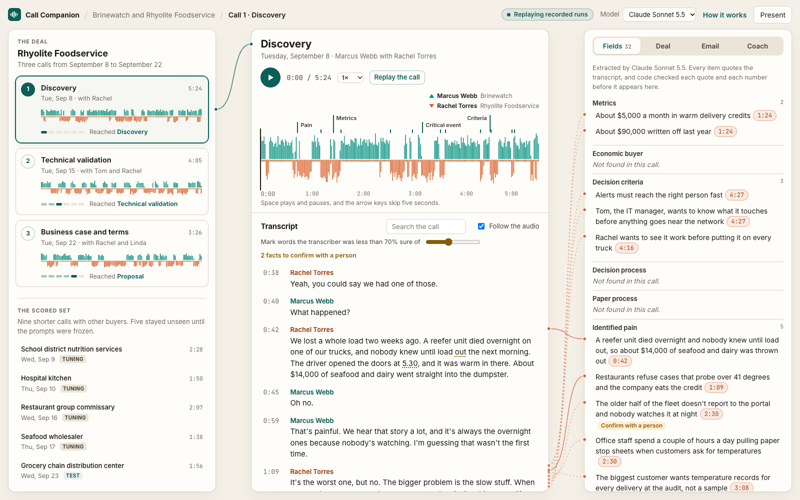
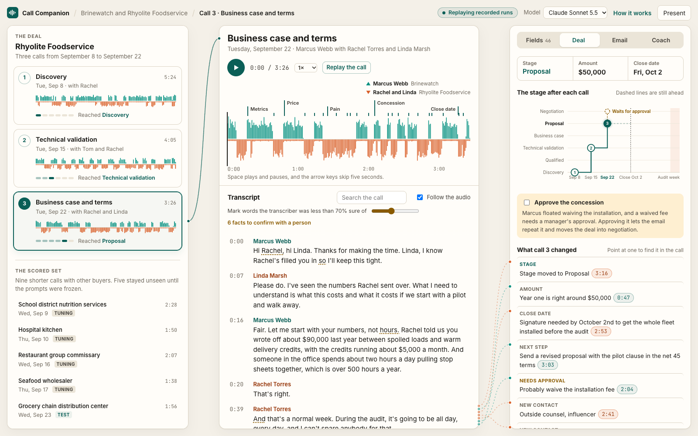
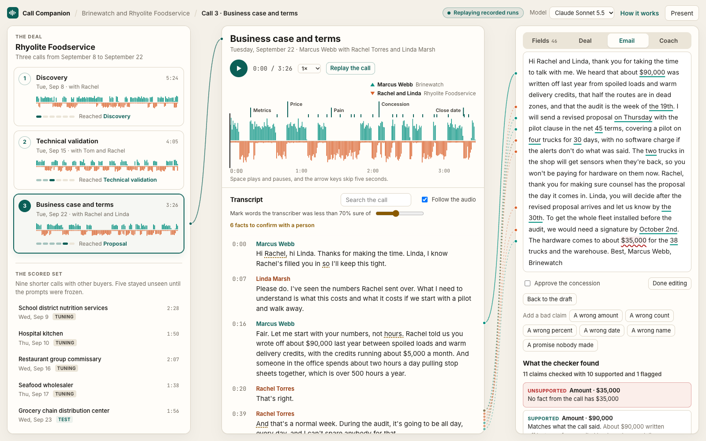
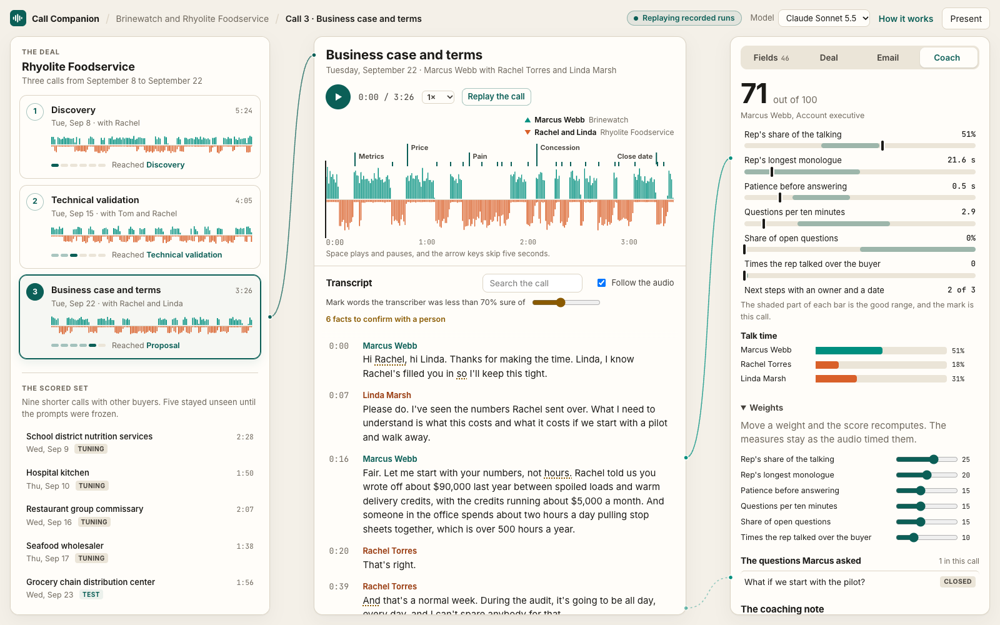

# Call Companion

A recorded sales call becomes CRM notes, a coaching scorecard, and a follow-up email. Every field the AI fills cites
the words it came from and the second they were said. Code confirms each quote and each number before anything is
shown, and a claim checker reads every number, date, name, and promise in the follow-up against the call.

[Open the demo](https://www.ryansansbury.com/call-companion/)



Every company, person, call, and number here is made up. The calls were scripted from an answer key and voiced by
stock text to speech voices. The answer key existed before any AI step ran.

## What it shows

- **Every output is tied to its source line.** A thread runs from each field, change, email claim, and coaching
  measure to the transcript line it came from. Point at either end to light it.
- **Replay a call and watch the record build itself.**
  Each fact lands the moment its quote has been said, the stage steps up when its rules are met, and the email and
  scorecard fill in when the call ends.
- **Click a CRM field and hear the buyer say it.** Each fact carries chips that play its moment in the call.
- **Type a promise into the follow-up and watch it caught.** The checker runs in the browser as you type.
- **The deal changes call by call.** Three calls move one opportunity through plain stage rules you can switch
  off, and a staircase shows the stage after each call against the close date.
- **Coaching from the audio's own timing.** Talk time, monologues, patience, and questions come from each person's
  track, and the weights are yours to set.
- **An honest scoreboard.** Every model is scored against the answer key on calls it never saw during tuning, and
  the misses are listed.

## Screens

The deal after call 3 as it waits for a manager's approval.



The follow-up with a wrong amount added and flagged.



The coaching scorecard from the call's own timing.



## The AI map

| Step | Who does it | How it's checked |
|---|---|---|
| Transcription | Whisper large-v3-turbo on a laptop for each person's track | Word error rate against the scripts |
| Who spoke when | Voice activity on each track (code) | Talk time against the mixer's record |
| The CRM fields | A model that quotes its evidence | Each quote must be in the transcript and each number in the quote |
| Uncertain words | A person | Facts with a doubtful number or name go to "Confirm with a person" |
| The record and stage | Rules in `config/crm.json` (code) | Tests |
| The follow-up email | A model working from the checked facts alone | The claim checker in Python and in the page |
| Concessions | A manager | Nothing off the price list reaches the email until it's approved |
| The scorecard | Code with weights you set | Tests and the question rule against hand labels |
| The coaching note | A model | Every point must quote its moment |

## Results

| Model | Calls | F1 | Precision | Recall | Held |
|---|---|---|---|---|---|
| Claude Sonnet 5.5 | Test (5) | 0.81 | 0.81 | 0.81 | 1.1% |
| Claude Sonnet 5.5 | The deal (3) | 0.81 | 0.78 | 0.85 | 0.0% |
| Claude Sonnet 5.5 | Tuning (4) | 0.81 | 0.75 | 0.88 | 1.1% |
| Claude Haiku 5.5 | Test (5) | 0.80 | 0.74 | 0.87 | 0.0% |
| Claude Haiku 5.5 | The deal (3) | 0.76 | 0.67 | 0.88 | 0.0% |
| Claude Haiku 5.5 | Tuning (4) | 0.78 | 0.73 | 0.84 | 0.0% |
| GPT-6 Luna | Test (5) | 0.78 | 0.79 | 0.77 | 1.1% |
| GPT-6 Luna | The deal (3) | 0.76 | 0.70 | 0.83 | 0.9% |
| GPT-6 Luna | Tuning (4) | 0.76 | 0.74 | 0.78 | 5.3% |

| Model | Cost per call | At 1,000 calls a month (estimate) | Seconds per call |
|---|---|---|---|
| Claude Sonnet 5.5 | $0.1378 | $137.80 | 38.4 |
| Claude Haiku 5.5 | $0.0127 | $12.70 | 77.3 |
| GPT-6 Luna | $0.0040 | $3.96 | 57.2 |

The claim checker caught 29 of 30 planted bad claims and raised a false alarm in 0 of 12 fair emails. Word error rate was 1.4% overall. Buyers came to 1.9% on the phone line and 1.6% before it.

## How the calls were made

Each call began as a list of the facts it has to hold, and the script came second. A validator confirms every fact's
words are actually spoken before anything is voiced. Kokoro-82M voices each line on its own speaker's track, and the
buyer's side runs through a simulated phone line with light noise. The deal is three calls between
Brinewatch and Rhyolite Foodservice. Brinewatch sells cold-chain monitoring, and Rhyolite is a regional food
distributor. The nine scored calls pair two reps with nine buyers, and five of them stayed unseen until the prompts
were frozen.

Synthetic audio is easier than a real call. These scores are an upper bound on what the same pipeline would do on
real recordings.

## Privacy

Transcription runs locally and the audio never leaves the machine. The text steps ran on cloud models through my own
accounts, and the page replays those recorded runs without calling any service.

## Running it

```
bash owner/bootstrap.sh                    # Python 3.12, Kokoro, mlx-whisper, ffmpeg, espeak-ng
bash owner/make_audio.sh                   # voice, mix and encode the calls
bash owner/transcribe.sh                   # transcribe each track
bash owner/record_ai_runs.sh --split dev   # record the AI steps
python3 build.py                           # build the page in site/ from what's on disk
python3 tests/run.py                       # the tests, the parity check and the page click-through
```

`python3 build.py --dev-preview` builds a labeled preview from the scripts alone without audio or a model.

## License

PolyForm Noncommercial 1.0.0. See LICENSE.
